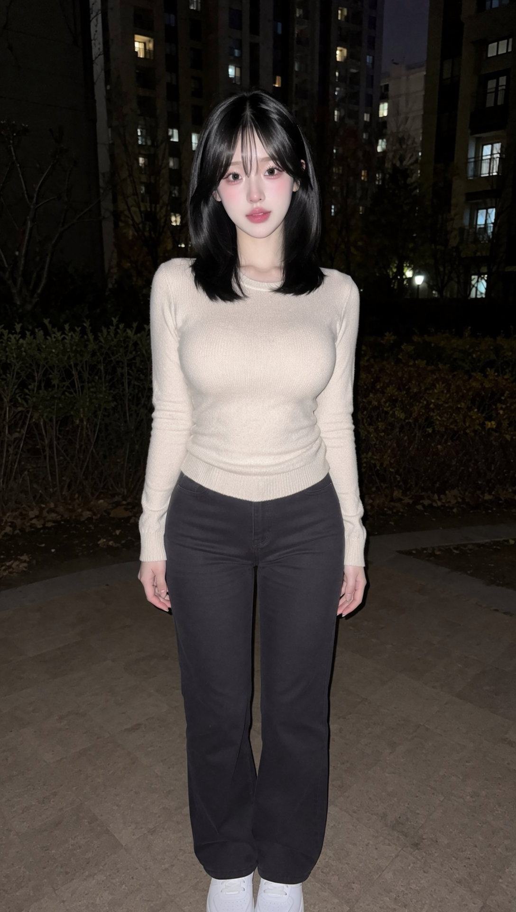
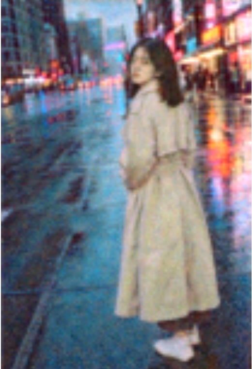

# moss-image-pose 📸

<p align="center">
  <a href="LICENSE"></a>
  <a href="https://github.com/OpenMOSS"></a>
  <a href="https://echidna.openmoss.com"></a>
  <a href="poses/poses.json"></a>
  <a href="#0-内容边界与模式"></a>
  <a href="scripts/build_layout.py"></a>
</p>

> **MOSS-Image 人像姿势与构图 Skill（非官方）**：告别 AI 随机抽卡抽姿势！说清要什么姿势、站哪里、什么机位，自动生成 MOSS-Image 原生精准布局 JSON，粘进 Echidna 工作台直接稳定出图。支持日常街拍、运动动态与**私房唯美曲线（Glamour / Boudoir）**姿势族。
> 
> 🤖 **适配 Agent**：Claude Code / Codex / Cursor / Antigravity / OpenClaw 等（Agent 直接读取 `SKILL.md` 即可调用），亦支持开发者在本地通过命令行纯 Python 运行。

---

## 🖼️ 效果实测展示 (Visual Showcase)

本项目通过**双层物理锁定**（边界框钉住空间坐标 + 逐关节英文解剖描述锁定姿态），彻底解决文生图模型中常见的人物位移、肢体畸变与构图失控问题。

<p align="center">
  
  
  <br/>
  <em>左：高清自然站姿立像实测（1088×1920，Euler 50 步，真实皮肤与发丝毛孔级细节）<br/>右：回眸 (stand_look_back) + 站右侧三分线 + 35mm 抓拍街拍（832×1248，Echidna 实测）</em>
</p>

### 经典用例实测对比

| 用例 | 推荐设置 | 布局策略 | 实测结果 | 对应示例文件 |
| :--- | :--- | :--- | :--- | :--- |
| **真实立姿** | 1088×1920，T0，50mm | 中心全身框，离底 4% | 站立稳定自然，皮肤肌理通透，衣物垂坠感真实 | [`examples/sample_stand_hd.png`](examples/) |
| **回眸（街景）** | 832×1248，T1，35mm | 右三分线边界框，左侧留白 | 人物精准落在右三分线，回眸转颈自然，左侧留白充分 | [`examples/t1_look_back*`](examples/) |
| **腾空跳跃** | 832×1248，T3，24mm | 居中悬空边界框，底部留空 | 双脚明确离地腾空、双臂上举，动作张力定格 | [`examples/t2_jump*`](examples/) |
| **双人分框** | 1248×832，两个独立框 | 左右独立分框，预留间隙 | 左右站位各司其职（抱臂+插兜），无肢体粘连与串色 | [`examples/t3_duo*`](examples/) |
| **趴着看书** | 1248×832，横版长框 | 贴近中心偏下居中 | 撑肘、小腿抬起交叉，全身横向入画无截断 | [`examples/t4_reading*`](examples/) |

---

## 🌟 核心亮点与分工

OpenMOSS 官方仓库自带通用的 `moss-image-prompt-enhancer`，主要负责通用描述扩写与海报、图表排版。**本仓库专精人像姿态与镜头控制**，二者输出同一种原生布局 JSON，可无缝配合使用：

| 维度 | 官方 Enhancer | 本仓库 `moss-image-pose` |
| :--- | :--- | :--- |
| **核心专注** | 通用场景：图文排版、电商海报、信息图 | **真实人像**：单人、双人、三人动作互动、**私房与唯美曲线** |
| **姿势控制** | 无专有人像姿态模型 | **内置 46 组逐关节骨骼解剖级描述库** |
| **边界框生成** | 依靠 Agent 凭借直觉画像素 | **根据 姿势 + 景别 + 站位 自动数学精确换算** |
| **构图控制** | 无焦距与机位梯度系统 | **独创 T0 到 T3 摄影机位张力阶梯** |
| **多人支持** | 容易肢体融合/串色 | **严格的多人独立边界框分配与防粘连算法** |

---

## 💋 私房与唯美曲线姿态族 (Glamour / Boudoir Poses)

应广大创作者对于轻熟、私房写真、浴后氛围与泳装唯美曲线的需求，特别扩充了 **Glamour 姿态家族**（内置于 [`poses/poses.json`](poses/poses.json)），并配套 `--allow-glamour` 选项，让用户可直接调用高张力、高质量的唯美姿态：

### 快速调用示例（复制即用）

```bash
# 示例 1：私房卧榻跪趴（慵懒回眸，微反弓腰线）
python3 scripts/build_layout.py --pose glamour_bed_kneel --allow-glamour \
  --width 832 --height 1248 \
  --subject "a stunning young East Asian woman in a dusty-pink ribbed knit mini dress" \
  --scene "a warm modern hotel bedroom at night, warm incandescent headboard light" \
  --style "candid photo, 35mm film grain, cinematic realism" \
  --out outputs/boudoir_kneel

# 示例 2：丝缎轻裹半掩（锁骨微露，半裹睡袍）
python3 scripts/build_layout.py --pose glamour_silk_wrap --allow-glamour \
  --width 832 --height 1248 \
  --subject "an elegant young woman draped loosely in a white silk robe" \
  --scene "a sunlit luxury bedroom in the morning, sheer curtains" \
  --style "glamour portrait, soft diffused lighting, natural skin texture" \
  --out outputs/boudoir_silk

# 示例 3：贵妃榻侧卧撩发（横版构图，S型身形）
python3 scripts/build_layout.py --pose glamour_sofa_recline --allow-glamour \
  --width 1248 --height 832 --framing full \
  --subject "a beautiful woman in deep wine-red velvet loungewear" \
  --scene "a vintage lounge with warm fireplace light" \
  --style "cinematic 35mm film photography, rich shadows" \
  --out outputs/glamour_sofa
```

> **💬 Agent 交互调用**：在聊天窗口直接对你的 AI 助手说：  
> `“帮我用 MOSS-Image 出一张私房跪趴姿势的图，穿粉色针织包臀裙”` 或  
> `“出个卧榻反弓美背的横版构图”`  
> 助手将自动从姿势库选取 `glamour_bed_kneel` 或 `glamour_bed_arch` 并换算好精准布局 JSON！

---

## 🧘 内置 46 款人体姿势库全览 (Pose Library)

姿势库数据位于 [`poses/poses.json`](poses/poses.json)，涵盖 11 大分类家族，全部经过严谨的关节与力学自洽性设计：

<details open>
<summary><b>👇 点击展开/折叠全部 46 种骨骼姿态清单</b></summary>

| 姿势 ID (`--pose`) | 中文名称 | 分类家族 | 张力等级 | 核心骨骼与姿态特征 |
| :--- | :--- | :--- | :---: | :--- |
| `glamour_bed_kneel` | **私房跪趴** | glamour | T1 | 跪趴于床榻前倾，腰背自然反弓，手肘/膝部承重，回眸眼神慵懒迷离 |
| `glamour_bed_arch` | **卧榻反弓美背** | glamour | T1 | 侧卧或伏卧于柔软床榻，脊柱微弓凸显腰臀S曲线，单肘托腮，肩线放松 |
| `glamour_silk_wrap` | **丝缎轻裹半掩** | glamour | T0 | 坐于床沿半裹丝质睡袍，双腿优雅交叠，锁骨微露，指尖搭膝，氛围感 |
| `glamour_sofa_recline` | **贵妃榻侧卧撩发** | glamour | T1 | 侧卧贵妃榻，单膝轻屈抬高腿线，指尖漫不经心撩拨颊侧发丝，神情自信 |
| `glamour_morning_stretch` | **晨起跪坐舒展** | glamour | T1 | 跪坐于洁白床单，双臂高举过顶做晨起伸展，挺胸仰首，腰部线条舒展 |
| `glamour_wall_turn` | **私房侧身提臀回眸** | glamour | T2 | 侧身靠墙站立，单手扶胯推高侧臀线条，另一手轻触墙面，锐利回眸 |
| `swimwear_poolside_edge` | **泳池池畔撑台** | glamour | T1 | 双小臂撑于泳池瓷砖池沿，水波泛动，脊背微弓挺起出水，水珠光泽 |
| `swimwear_sunbathe` | **沙滩日光浴侧卧** | glamour | T0 | 侧身卧于金色细沙滩，单手屈肘撑头，双腿微曲交错，阳光微光小麦肤 |
| `stand_relaxed` | 放松站立 | standing | T0 | 单腿受力微屈，双臂自然垂落身体两侧，肩膀放松面朝镜头 |
| `stand_contrapposto` | 对立式站姿 | standing | T1 | 经典对立式力学，重心压于右腿，骨盆微侧倾，左手搭胯，头颈微转 |
| `stand_arms_crossed` | 抱臂站立 | standing | T0 | 挺拔站立，双臂自然环抱胸前，双脚与肩同宽 |
| `stand_hands_pockets` | 插兜站立 | standing | T0 | 随意站姿，双手插裤兜或大衣兜，单脚前跨半步微屈 |
| `stand_look_back` | 回眸 | standing | T1 | 背对镜头 3/4 站立，上身回旋扭转，越过肩头回首凝视镜头 |
| `stand_hair_touch` | 撩发 | standing | T1 | 站姿，单手抬起指尖轻拂耳后发丝，手肘自然抬起 |
| `stand_lean_wall` | 靠墙 | leaning | T1 | 单侧肩背微倚墙面，单足后抵墙基，姿态闲适 |
| `lean_railing` | 倚栏杆 | leaning | T1 | 上身前倾，双小臂撑搭于栏杆上，手腕自然垂悬，眺望前方 |
| `walk_forward` | 迎面走来 | motion | T1 | 迎面迈步，左脚向前落步，双臂自然随步伐前后摆动 |
| `walk_side` | 侧面行走 | motion | T1 | 完整正侧面剪影，大跨步前行，长风衣/衣摆带出微风动态 |
| `run_jog` | 慢跑 | motion | T2 | 斜向慢跑姿态，单足离地腾空，膝部抬高，双手握拳摆臂 |
| `jump_mid_air` | 腾空跳跃 | motion | T3 | 双脚悬空离地定格，双膝微屈，双臂向斜上方舒展伸张 |
| `spin_dress` | 转圈 | motion | T2 | 原地回旋，双臂展开维持平衡，裙摆或发丝向外飞扬绽放 |
| `dance_reach` | 舞蹈伸展 | dance | T3 | 现代舞姿态，单臂向斜上方延伸，另一臂划出优美弧线，脊柱拉伸 |
| `ballet_arabesque` | 芭蕾迎风展翅 | dance | T3 | 经典阿拉贝斯克，单腿直立承重，另一腿向后笔直抬高水平延伸 |
| `sit_chair_cross` | 椅上翘腿 | sitting | T0 | 端坐木椅，优雅双腿交叠翘二郎腿，双手轻叠置于膝盖 |
| `sit_chair_reverse` | 反坐椅子 | sitting | T1 | 跨骑反坐椅子，胸口贴近椅背，双臂交叠伏在椅背上沿 |
| `sit_floor_hug_knees` | 抱膝坐地 | sitting | T0 | 席地而坐，双膝屈起贴近胸前，双臂紧紧环抱膝部 |
| `sit_floor_side` | 侧坐 | sitting | T1 | 双腿屈膝并拢斜向一侧，单手侧向撑地分担体重，脊骨挺立 |
| `sit_stairs` | 坐台阶 | sitting | T0 | 坐在户外石阶，双足踩在下方梯级，手肘搭在膝盖上 |
| `sit_edge_dangle` | 坐边缘晃腿 | sitting | T1 | 坐在矮墙/长凳边缘，双腿自然垂悬悬空，双手撑在身体两侧 |
| `sit_cafe_chin` | 托腮 | sitting | T0 | 坐于桌前，单侧手肘撑桌面，指掌托住下颌或脸颊，若有所思 |
| `crouch_low` | 蹲姿 | crouching | T1 | 足前掌点地深蹲，膝部微拢，手肘搁于膝头，街头潮流感 |
| `kneel_one` | 单膝跪 | crouching | T1 | 单膝触地承重，另一脚前踏立足，单臂垂于前膝 |
| `lie_grass_back` | 仰躺草地 | lying | T1 | 穿着完备仰卧在草坪上，双臂向两侧舒展，头枕微风 |
| `lie_belly_reading` | 趴着看书 | lying | T0 | 伏趴于地毯，双肘支地撑起上半身，双手捧书，小腿后翘交叠 |
| `lie_side_propped` | 侧卧撑头 | lying | T1 | 侧卧于沙发，单臂屈肘掌托头部，另一臂平放腰间 |
| `gesture_peace` | 比耶 (剪刀手) | gesture | T0 | 站姿，单手在脸侧比出 V 字手势，眼神明亮亲和 |
| `gesture_frame_hands` | 手指取景框 | gesture | T1 | 双手食指与拇指在眼前交错拼出矩形相机取景框 |
| `gesture_umbrella` | 撑伞 | gesture | T0 | 单手高擎透明雨伞，伞柄微倾，雨滴从伞骨滑落 |
| `gesture_phone_selfie` | 举手机自拍 | gesture | T0 | 单臂向前上方斜举智能手机，侧头对着屏幕微笑 |
| `sport_basketball_shot` | 投篮动作 | sport | T3 | 跳投峰值，双脚离地跃起，篮球举过额头，手腕压腕准备出手 |
| `sport_yoga_tree` | 瑜伽树式 | sport | T1 | 单腿站立扎根，另一足底紧贴支撑腿大腿内侧，双手胸前合十 |
| `sport_stretch_side` | 侧拉伸 | sport | T2 | 双脚宽距站立，单臂向侧上方深长拉伸，侧腰延展线条鲜明 |
| `duo_holding_hands` | 双人牵手 | duo | T0 | 两人并排漫步，内侧双手紧扣，步调一致前行 |
| `duo_back_to_back` | 双人背靠背 | duo | T1 | 两人背对背紧贴伫立，双臂交抱，各自看向侧方 |
| `duo_high_five` | 腾空击掌 | duo | T2 | 两人迎面跃起，在空中手掌高位清脆击掌，充满活力 |
| `duo_piggyback` | 双人背人 | duo | T2 | 一人背负另一人，双手托住对方腿弯，背上之人双手自然揽颈 |

</details>

---

## 📐 T0–T3 构图张力阶梯系统

根据镜头焦距、拍摄俯仰角与肢体幅度，划分为四个张力等级（仅受机位和动态决定，与画面尺度无关）：

| 等级 | 镜头机位与构图风格 | 适合姿势分类 | 画面情绪 |
| :---: | :--- | :--- | :--- |
| **T0** | 平视水平视角，50mm 标准人像，严谨黄金分割或对称平衡 | 基础站姿、坐姿、托腮、丝缎轻裹、沙滩侧卧 | 恬静、日常、故事感、稳定 |
| **T1** | 微俯仰角/侧向，35mm 广角抓拍，三分线构图 | 回眸、靠墙倚立、私房跪趴、卧榻反弓美背 | 街拍抓拍、松弛感、互动感 |
| **T2** | 低机位仰角，28mm 广角，透视对角线构图 | 慢跑奔跑、侧身旋转、私房提臀侧立、大幅拉伸 | 运动张力、冲击力、空间深度 |
| **T3** | 极端超低俯仰视角，24mm 超广角，动作峰值定格 | 腾空暴扣、高空跃起、芭蕾舞姿大跳 | 强震撼定格、速度感、戏剧性 |

---

## 🚀 快速上手 (Quick Start)

### 方式一：本地 Python 脚本生成布局

你可以直接运行本地脚本导出单行布局 JSON 和详细参数：

```bash
# 查看所有可用姿势与说明
python3 scripts/build_layout.py --list

# 示例 1：常规人像 · 回眸街拍（站右侧三分线）
python3 scripts/build_layout.py --pose stand_look_back --position right \
  --width 832 --height 1248 \
  --subject "a young East Asian woman in a beige trench coat and white sneakers" \
  --scene "a rainy city street at dusk, neon reflections on wet pavement" \
  --style "cinematic street photo, 35mm film grain" \
  --light "cool blue dusk light mixed with warm neon" \
  --out outputs/look_back

# 示例 2：私房唯美曲线 · 跪趴床榻
python3 scripts/build_layout.py --pose glamour_bed_kneel --allow-glamour \
  --width 832 --height 1248 \
  --subject "a stunning young woman in a dusty-pink ribbed knit mini dress" \
  --scene "a warm modern hotel bedroom at night" \
  --style "candid photo, 35mm film grain, cinematic realism" \
  --out outputs/boudoir_case

# 示例 3：双人分框 · 左右站立（插兜 + 抱臂）
python3 scripts/build_layout.py --pose stand_hands_pockets,stand_arms_crossed \
  --width 1248 --height 832 \
  --subject "a young man in a black leather jacket || a young woman in a cream knit sweater" \
  --scene "a cozy bookstore with warm wooden shelves" \
  --out outputs/duo_bookstore
```

脚本将生成：
* `outputs/*.layout.min.txt`：已最小化压缩的单行 MOSS-Image 布局 JSON（直接复制即可使用）。
* `outputs/*.params.json`：推荐搭配的推理采样参数。
* `outputs/*.prompt.txt`：拼合好的全景英文 Prompt。

---

### 方式二：在 Echidna 在线工作台出图（实操步骤）

1. 打开 [Echidna 工作台](https://echidna.openmoss.com)，模型选择 **MOSS-Image-SFT**，停留在 **「文生图」** 标签。
2. **先定分辨率**：在「画面与采样」中选择与布局一致的分辨率（推荐竖版 `832×1248`、横版 `1248×832`，必须为 16 的倍数）。
3. **粘贴布局**：将 `*.layout.min.txt` 中的**整段单行 JSON** 直接粘进 **「正向 Prompt」** 输入框（无须打开繁琐的布局编辑器）。
4. **反向词与高级设置**：
   * **反向 Prompt** 填入：`nsfw, worst quality, bad anatomy, extra limbs, extra fingers, watermark, jpeg artifact`（若生成私房或清凉服装，负面词可移除 `nsfw`，保留其余画质词）。
   * **高级设置核对**：步数 `50`、CFG `3.0`、Shift `5.0`、采样器 `Euler`、**跳层选第 22 层（仅负向）**。
5. 点击 **「生成」**，单张约 35 秒即可收获姿势精准的高清大图！

---

## 🛠️ 常见问题排查 (Troubleshooting)

| 遇到问题 | 诊断排查 | 解决方案 |
| :--- | :--- | :--- |
| **姿势不准确** | 骨骼关键动作权重不够 | 将最重要的肢体姿势描述移至 `character.caption` 的最前列；核对 4 项关键关节（重心、双臂、双腿、头部朝向）。 |
| **人物位置偏移** | 画布长宽比与布局不匹配 | 确保工作台设置的像素宽高与生成布局时的 `--width / --height` 完全一致。 |
| **全身照脚被裁断** | 边界框下沿越界或贴底 | 确保全身框底部离画面下沿预留至少 4% 空间，Prompt 中必须保留 `head to toe visible`。 |
| **手指崩坏变形** | 采样跳层偏离最优层 | 务必确保高级设置中打开了 **第 22 层跳层（仅负向）**，负面提示词中必须包含 `extra fingers`。 |
| **画面过于油腻或假** | 风格描述缺乏真实光学 | 在 Prompt 中加入 `candid photo, natural skin texture, 35mm photograph`，跳层微调为 24 层。 |
| **双人出现肢体粘连** | 人物框距离过近重叠 | 检查导出的布局 JSON，确保两个 `character` 边界框中间保留了自然空隙。 |

---

## 0. 内容边界与模式

* **默认 SFW 模式**：适用于大众街拍、运动、日常与职业写真。
* **Glamour 私房与唯美曲线模式**：支持私房人像写真、唯美泳装、丝缎吊带睡裙、卧榻反弓美背等摄影级艺术构图（`--allow-glamour`）。
* **底线红线**：严格禁止全裸、露骨色情、生殖露点及任何违规违法内容。
* **隐私保护**：不生成任何真实公众人物或特定个人的可识别肖像。

---

## 📁 仓库目录结构

```text
moss-image-pose/
├── README.md               # 完整的图文展示与使用说明
├── SKILL.md                # Agent 技能规范与系统级提示词规则
├── LICENSE                 # Apache 2.0 开源许可协议
├── poses/
│   └── poses.json          # 46 款预置骨骼解剖级姿态数据库（含 Glamour 姿态族）
├── scripts/
│   └── build_layout.py     # 布局换算、边界框生成与参数导出脚本
└── examples/               # 经典实测用例
    ├── sample_stand_hd.png        # 高清全身立姿实拍样张 (1088×1920)
    ├── t1_look_back_clean.png     # 回眸街拍裁剪效果图
    ├── t1_look_back.*             # 回眸（单人街景）
    ├── t2_jump.*                  # 腾空跳跃（运动姿态）
    ├── t3_duo.*                   # 双人分框（左右独立站位）
    └── t4_reading.*               # 趴地看书（横版构图）
```

---

## 📄 开源许可与致谢

* 本项目核心代码、姿态数据库与设计规范基于 [Apache License 2.0](LICENSE) 开源。
* 感谢 [OpenMOSS](https://github.com/OpenMOSS) 团队开源的高性能 MOSS-Image 文生图模型与 Echidna 实验工作台。
